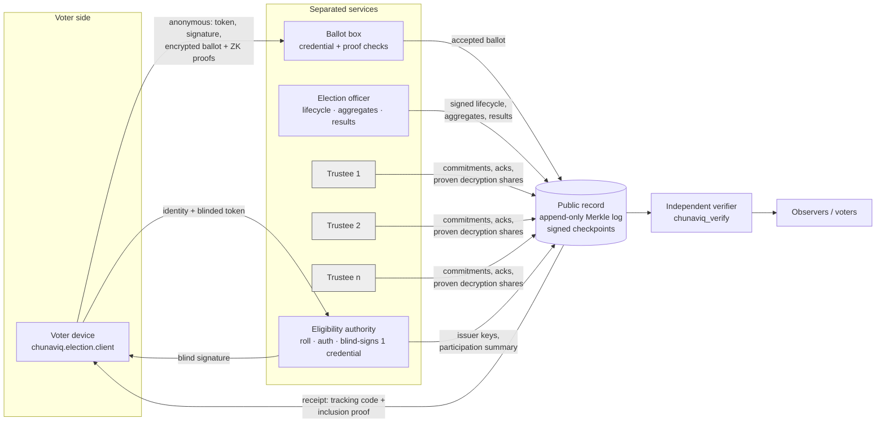

# Architecture

## Components → code

| Component (blueprint) | Module | Notes |
|---|---|---|
| Identity & eligibility service | `chunaviq/election/eligibility.py` | SQLite roll, salted HMAC auth stand-in, lockout, revocation, one-credential PK, RSA blind signing per constituency |
| Privacy-preserving ballot protocol | `chunaviq/crypto/{elgamal,proofs,blind}.py`, `chunaviq/election/ballot.py` | Exponential ElGamal, CDS 0/1 proofs, CP limit proof, blind credentials |
| Ballot interface | `chunaviq/election/client.py` | Simulated device incl. Benaloh challenge. No browser UI yet (see roadmap) |
| Ballot storage | `chunaviq/election/ballotbox.py`, `chunaviq/election/board.py` | Board is authoritative; DB is a rebuildable index |
| Audit record | `chunaviq/election/board.py`, `chunaviq/crypto/merkle.py` | RFC 6962 log, Ed25519 checkpoints, consistency proofs |
| Key custody | `chunaviq/crypto/threshold.py`, `chunaviq/election/administration.py` | Feldman VSS k-of-n; coefficients destroyed after ceremony |
| Tally engine | `chunaviq/election/administration.py` | Aggregates only; CP-proven shares; Lagrange combine |
| Independent verification | `chunaviq_verify/` | No imports from `chunaviq`; own constants; re-derives group |
| Observer interface | `chunaviq/report.py` | Static, script-free, accessible HTML from the verifier's JSON |
| Simulation harness | `chunaviq/election/simulate.py` | Synthetic roll, parallel client/server crypto, injected attacks, ground-truth oracle |

The blueprint's `apps/ services/ crypto/` folders map to the Python package layout above (`src/chunaviq/election` = services, `src/chunaviq/crypto` = crypto, `src/chunaviq/report.py` + CLI = apps).

## Data separation

| Store | Contents | Never contains |
|---|---|---|
| `private/eligibility.db` | voter_id, constituency, auth salt+HMAC, status, issuance row (participation commitment + salt, hour bucket) | tokens, signatures, ballots, tracking codes |
| `private/ballotbox.db` | used tokens, ciphertext α values | voter ids, auth data, commitments |
| `record/` (public) | everything in `spec/record-format.md` | voter ids, auth data, IPs, exact timestamps |
| Trustee memory | own key share | other shares, the joint secret |

## Concurrency and failure model

* Single writer to the board; any number of readers.
* Expensive proof checks run outside the lock (and in worker processes in the simulator); uniqueness checks and the board append run inside one lock + one IMMEDIATE transaction.
* Crash between board append and index commit → `rebuild_index()` restores the index from the board.
* Tally aborts **before publishing anything** if fewer than k trustees are available.
