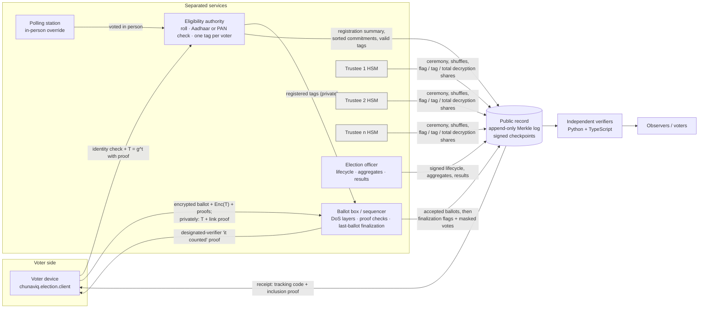

# Architecture (protocol v2)

## Two implementations

| | Python (`src/`) | TypeScript (`web/src/engine/`) |
|---|---|---|
| Purpose | Reference engine, HTTP service, simulation, dress rehearsal, CLI | Interactive browser demo |
| Verifier | `chunaviq_verify` (no imports from `chunaviq`) | `verifier.ts` (no imports from the TS election engine) |
| Big integers | Python ints, optional GMP | `BigInt`, fixed-window exponentiation |
| Hashes / signatures | `hashlib` / `cryptography` | `@noble/hashes` (SHA-256, SHAKE-256) / `@noble/curves` |
| Parallelism | process pools (finalize, mix, verify) | Web Worker pool (prepare, precheck, finalize, mix, verify) |

Both write and read `chunaviq-record/2` byte for byte; CI cross-verifies in both directions.

## Components → code

| Component | Module | Notes |
|---|---|---|
| Identity (synthetic UIDAI, PAN, SMS, face) | `election/identity.py` | Aadhaar OTP / face; PAN name+DOB **plus** roll-mobile OTP **plus** face; HMAC-hashed identifiers |
| Eligibility & registration | `election/eligibility.py` | Roll, lockout, one tag per voter, re-registration, polling-day override, registration publication |
| Ballot protocol | `crypto/{elgamal,proofs,sigma}.py`, `election/ballot.py` | Exponential ElGamal, CDS 0/1, CP limit, tag PoK bound to body, private link proof |
| Voter device | `election/client.py` | Register, prepare, Benaloh, cast, revote, check "it counted", fake that proof |
| Ballot box | `election/ballotbox.py`, `election/board.py` | Tag-aware idempotency, revote limit, group commit, finalization with OR-proofs |
| Network service | `service/{httpd,sequencer}.py` | asyncio HTTP with limits; token bucket, load shedding, cheap-checks-first, process-pool proofs |
| Mixing | `crypto/shuffle.py`, `election/administration.py` | Terelius–Wikström shuffles by ≥ 3 trustees per batch |
| Key custody | `custody.py`, `crypto/threshold.py` | HSM applet: in-HSM DKG, sealed transport, policy-gated decryption, signed audit log, seal/clone |
| Tally | `election/administration.py` | Flags → counted tags → masked totals; BSGS |
| Federation | `election/federation.py`, `chunaviq_verify/federation.py` | One national key ceremony; 543 independent shards |
| Load & rehearsal | `service/{loadgen,rehearsal}.py` | Poisson honest voters + 7 attack kinds; full election under attack; published outputs |
| Observer interface | `report.py`, website `#/evidence` | Static report; rehearsal and capacity pages |

## Data separation

| Store | Contents | Never contains |
|---|---|---|
| `private/eligibility.db` | voter_id, HMAC'd identity references, status, tag, generation, commitment + salt, in-person flag | ballots, tracking codes |
| `private/ballotbox.db` | registered tags; tag ↔ ballot sequence (for finalization); α index | voter ids, identity data |
| `record/` (public) | everything in `spec/record-format.md` | voter ids, plaintext tags, link proofs, IPs, exact timestamps |
| Trustee HSM | one share of the national key, attestation and transport keys, audit log | other shares, the joint secret |

The ballot box's tag ↔ ballot index is private and is needed to finalize. Losing it after close means restoring the sequencer backup; it cannot be rebuilt from the public record (by design: the public cannot see which ballots share a tag).

## Concurrency and failure model

* Single writer per constituency to the board; any number of readers.
* Expensive proofs run outside the lock (process pool); uniqueness, revote limit and the board append run inside one lock and one IMMEDIATE transaction per batch.
* Finalization, mixing and decryption are refused while the election is open; all of them stream in bounded batches.
* Tally aborts **before publishing anything** without a quorum.
