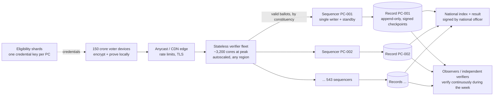

# Running ChunavIQ for 100–150 crore electors over seven days

**Bottom line.** The cryptography and data structures now scale to a national election, and that claim rests on measured unit costs and tests at real constituency sizes, not on running 150 crore ballots. Throughput is the easy part: about 3,200 CPU cores verify ballots at the busiest hour. What no amount of software here can settle is whether remote voting is *acceptable* at that scale: coercion, identity verification for 150 crore people, denial of service and the law. Those are listed at the end and stay open.

All numbers below come from [`docs/scale/capacity.md`](scale/capacity.md), which `chunaviq capacity` regenerates from fresh measurements.

## 1. Shape of the system



**Why one shard per constituency works with no coordination.** A credential is a blind signature over `election ‖ constituency ‖ token`, and each constituency has its own signing key. A credential can only ever be valid in one constituency, so "has this credential voted?" is a question one sequencer answers alone. Copied ciphertexts fail across shards too, because every proof is bound to its constituency. No global lock, global database or cross-shard transaction exists on the voting path.

| Component | Count | State | Scales by |
|---|---|---|---|
| Voter device | 150 crore | its own ballot secrets | n/a (each does ~70 ms of work) |
| Verifier fleet | ~3,200 cores at design peak | none | adding machines |
| Sequencer (ballot box + record) | 543, one per Lok Sabha seat | used credentials, ciphertext index, append-only log | adding shards (could split to ~4,120 assembly segments) |
| Eligibility service | sharded by constituency | roll + issuance | adding shards |
| Trustees | 5 people, k = 3 | one key share per shard (543), in HSMs | n/a; tally work is ~15 s each |
| National layer | 1 | signed manifest, shard index, result | n/a |

Federation format: [`spec/federation.md`](../spec/federation.md). Run one: `chunaviq federate out --shards 24`; verify it: `chunaviq verify-federation out`.

## 2. What changed in the code to make this true

| Problem found | Fix | Proof |
|---|---|---|
| Counting a seat with ~58 lakh votes by linear search: hours per option | Baby-step giant-step in all four implementations (Python and TypeScript, election and verifier) | `test_count_recovery_at_constituency_scale_both_implementations`, `test_threshold_tally_of_a_58_lakh_vote_total`: 70 ms |
| Board, tally and verifier held the **whole record in RAM**. The largest seat at 150 crore electors is ~330 GB of record | Board keeps only Merkle hashes, byte offsets and counters; tally streams; verifier streams in bounded chunks with an on-disk duplicate index | `test_verifier_memory_does_not_grow_with_record_size` (4× ballots, < 1.5× memory), `test_board_keeps_bodies_on_disk`; 10,000-voter record verified in 106 MB |
| One `fsync` per ballot | Group commit: one transaction and one `fsync` per batch; voters are acknowledged only after it | `test_group_commit_enforces_uniqueness_within_and_across_batches`; ~1,200 ballots/s per shard on 2 cores vs ~116/s needed (10× headroom) |
| A device retrying after a dropped connection got "credential already used" and lost its receipt | Identical resubmissions return the original receipt; nothing is recorded twice | `test_identical_retry_returns_original_receipt`, 16-way concurrent retry test |
| One election = one log | National federation: per-constituency records bound to a signed national manifest and shard index | `test_federation_*`: verifies; catches a missing shard, swapped shards, an altered national result |

## 3. Your ten points, checked

| # | Point | Verdict | Detail |
|---|---|---|---|
| 1 | Distributed infrastructure | **Right, with a specific shape** | Stateless verifiers spread anywhere and autoscale. Sequencers are *stateful single writers*, one per constituency, each with a hot standby and synchronous log replication to a second region. Avoid a single global database. |
| 2 | 1,653–2,480 votes/s | **Arithmetic right, assumption wrong** | That spreads votes evenly over 24×7. People vote in daylight and rush at the end: busiest hour ≈ **14,900/s** at 150 crore and 100% turnout, **design for ~29,800/s**. More importantly, a ballot costs ~100 ms of CPU to verify, so this is a *CPU* problem (~3,200 cores), not a requests-per-second problem. |
| 3 | Horizontal scaling, durability, idempotent retries | **Right; idempotency was missing** | Added (section 2). Durability: acknowledge only after the batch is fsynced and replicated. |
| 4 | Separate eligibility service | **Right; now sharded** | One credential key per constituency. The real hard part is not software: verifying 150 crore identities remotely. OTP to a phone number on the roll is weak (SIM swap, shared phones). Using Aadhaar would need legal authorisation (`docs/legal-scope-india.md`). **Unsolved.** |
| 5 | Secret ballot, reviewed cryptography | **Right** | Already true (threshold decryption of totals only, blind credentials). At national scale, arrival-order linkage by a network-level observer matters more: batch or mix before posting (finding F-005). |
| 6 | Verifiable counting, tamper-evident logs | **Right; add timing** | Re-verifying the whole election after close takes ~22 h on 2,000 cores. Observers should **verify continuously during the week** (~250 cores keep pace with the average rate), so only the last hours remain at close. Two independent verifier implementations already exist. |
| 7 | Pen tests, key management, DoS, insiders | **Right** | Specific to scale: 543 shard key shares per trustee must live in HSMs, and DoS is the most likely real-world failure. A seven-day window *helps* availability but *lengthens* the time keys are live and voters can be coerced. |
| 8 | Simulate 1.5 billion synthetic electors | **Partly wrong** | Not needed for correctness and not sufficient for availability. Correctness comes from per-shard tests at real sizes, plus the fact that shards are independent, so capacity adds linearly. Availability needs a **full-volume dress rehearsal on the real infrastructure**: at minimum one full-size constituency (~58 lakh ballots) end to end, and the verifier fleet held at the design rate for hours. That cannot be done from this repository. |
| 9 | GitHub for code, not votes | **Right** | Already in place: CI, reviews, SHA-pinned actions, hash-locked dependencies, release attestations. |
| 10 | Legal authorisation | **Right** | For Lok Sabha and assembly elections, remote online voting would need changes under the Representation of the People Act and Conduct of Election Rules, decided by Parliament and the Election Commission. Software readiness does not substitute. |

**Missing from the list:**
- **Record size.** About 86 TB at 150 crore electors and 100% turnout (~56 KiB per 16-option ballot), or 259 TB stored with replicas. Switching from the 2048-bit group to an elliptic-curve group would cut ballot size and CPU several-fold. That is an estimate, not measured here, and it is the single biggest optimisation available.
- **Voter devices.** Encrypting a 16-option ballot takes ~70 ms on a server core; low-end phones are perhaps 10–30× slower, which is still seconds.
- **Constituencies with many candidates.** A 50-option ballot costs ~3× as much to verify; plan cores for the worst seat, not the average.
- **Coverage, languages and connectivity.** 22 scheduled languages, screen readers, and voters with poor connectivity. Retries are now safe, but offline voting is not possible.

## 4. What is proven, modelled and open

| Status | What |
|---|---|
| **Proven by tests** | Counting at 58 lakh votes per option; threshold tally at that size; federation verification and tamper detection; bounded verifier and board memory; group-commit uniqueness; idempotent retries; sequencer ingest above the largest seat's need |
| **Measured, then modelled** | Cores, bandwidth, storage, tally and re-verification times (`docs/scale/capacity.md`). Assumptions are explicit and editable |
| **Not done (needs real infrastructure)** | Full-volume dress rehearsal; multi-region failover drills; DoS testing; HSM key custody for 543 × 5 shares |
| **Not solvable in software alone** | Coercion and vote-buying in remote voting; remote identity verification at 150 crore scale; legal authorisation |

## 5. Running the scale checks

```bash
make scale-national    # pytest -m scale: counting at constituency scale, federation, memory, ingest (~1-2 min)
make capacity          # re-measure unit costs, regenerate docs/scale/capacity.md
chunaviq federate out --shards 24 --voters-per-shard 300 && chunaviq verify-federation out
```
